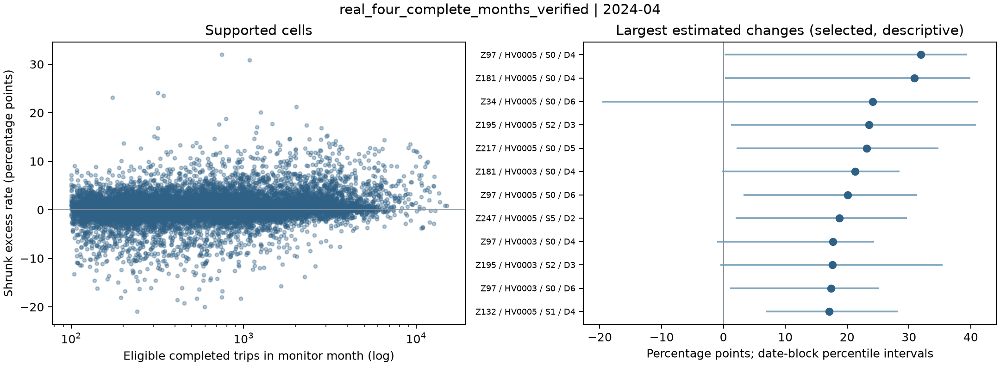

# TLC service interval monitor

A statistical monitoring system that turns New York City high-volume for-hire vehicle trip records into a monthly service review queue. The pipeline connects streaming data processing, empirical-Bayes estimation, date-level resampling, and a retrospective ranking evaluation.

The decision is concrete: **which twenty service segments should an analyst inspect first?** Ranking the largest observed rates alone can repeatedly select segments with persistently high baselines. Ranking changes alone can elevate noisy, sparsely observed cells. This project makes the reference population, amount of evidence, and ranking rule explicit before producing a review list.

The recorded January–April 2024 run scanned **80,036,904** source rows and retained **79,056,061** eligible completed trips. The repository includes aggregate outputs, executable analysis, an offline HTML report generator, and tests for statistical and data-processing invariants.



## Statistical question

For each completed trip, the event is a request-to-pickup interval **strictly longer than 600 seconds**. The recorded configuration retains intervals up to 7,200 seconds and applies validity and month-boundary filters. The quantity being monitored is therefore the event rate among eligible completed trips.

A comparison cell consists of pickup zone, platform, four-hour time slot, and weekday. Within a cell, daily counts record the number of eligible trips, $n_d$, and the number exceeding the threshold, $k_d$. This preserves the distinction between a change in service intervals and a change in the mix of trips being observed.

The April analysis uses January–March as its reference. The target is the current-minus-reference rate difference in percentage points, rather than a citywide average or a ranking of zones by their usual service conditions.

## Estimation and review logic

### Borrowing information from historical peers

Let $(k,n)$ denote current counts and $(k_0,n_0)$ reference counts. The parent rate $p_0$ is estimated from reference trips sharing the platform, slot, and weekday, pooling across zones. Both periods use that same reference-only parent:

$$
\widetilde p=\frac{k+\tau p_0}{n+\tau},\qquad
\widetilde p_{\mathrm{ref}}=\frac{k_0+\tau p_0}{n_0+\tau},\qquad
\widetilde\Delta=100(\widetilde p-\widetilde p_{\mathrm{ref}}).
$$

The default strength is $\tau=50$. For an interior parent rate this is the posterior mean under a Beta prior with parameters $\tau p_0$ and $\tau(1-p_0)$. Its weighted-average form explains the behavior: small cells borrow more from their historical peers, while large cells remain close to their own observed rates. The parent estimate is fitted before the monitoring month; future records cannot alter it.

### Evidence before priority

A supported comparison needs at least 100 current trips on three observed dates and 300 reference trips on six observed dates. Within each supported cell, the analysis independently resamples current and reference dates, carrying each date's $(n_d,k_d)$ pair together. It computes 300 resampled differences and a 95% percentile interval, holding the fitted parent rate fixed.

The priority queue requires positive raw change, positive shrunk change, and a positive lower interval endpoint. The raw-change condition matters: different sample sizes assign different weights to the same prior, so shrinkage alone can produce a positive difference even when both periods contain zero events. An explicit test protects against this case.

Eligible cells are ranked by shrunk change, with deterministic tie-breaking. The queue contains at most twenty entries; it is never padded with unsupported cells. The intervals describe variation conditional on the fitted prior and support an investigation queue, rather than simultaneous inference over every screened cell.

### Separating service change from composition change

A complementary zone-level calculation freezes each zone's reference distribution over platform, slot, and weekday. Current and reference cell rates are averaged using those same weights. Full reference-weight coverage is required by default: an absent current cell does not become a zero-risk observation. This provides a second view of the data when aggregate rates move because the trip mix changes.

The [research design](docs/research-design.md) develops the estimands, shrinkage calculation, resampling assumptions, and evaluation controls in more detail.

## Recorded analysis

The four-month run produces **367,392 daily aggregate rows**. April contains **21,531 candidate cells**, of which **18,288** satisfy the support requirements; twenty enter the review queue. Source rows, retained trips, daily rows, and comparison cells are recorded separately in the [analysis summary](examples/pilot_verified/summary.json), because they represent different stages of the computation.

To examine persistence, a separate configuration uses January–February as reference, ranks March cells, and evaluates their April observations. All three ranking methods use the same pool of **17,300 supported cells**. A hit requires the April raw rate to exceed the **original, frozen reference rate** by more than two percentage points.

| Ranking on March observations | Observable selections | Persistent in April |
|---|---:|---:|
| Raw event rate | 20 | 13 |
| Raw change from reference | 20 | 15 |
| Shrunk change from reference | 20 | 15 |

The separate priority queue also retains 15 of 20 selections. In this window, the two change-based rankings identify more persistent excesses than raw-rate ranking; their equal counts do not establish an advantage of shrinkage over raw change. The queue additionally enforces the evidence conditions described above. Exact denominators and windows are in the [forward-check summary](examples/pilot_forwardcheck/summary.json) and [evaluation table](examples/pilot_forwardcheck/evaluation.csv).

The April queue has no May observations in the recorded dataset, so its subsequent outcomes remain unknown. The March-to-April check evaluates persistence in released records, not a dispatch intervention or unmet passenger demand.

## Engineering the analysis

The ingestion path reads the four required Parquet columns in batches and aggregates accepted trips directly into daily counts. A mutually exclusive filter ledger accounts for rejected rows, allowing scanned, accepted, and panel totals to be reconciled. Trip batches are bounded in size; the in-memory aggregate grows with the number of distinct daily cells.

A completed month can be reused only when processing parameters, source metadata, and the saved panel hash match. This prevents an old aggregate from silently surviving a changed filter or source. The analysis validates calendar dates, weekdays, source months, and integer event counts before comparing windows.

Random streams are derived from the seed and cell key. Adding an unrelated cell therefore does not change an existing cell's bootstrap interval. Missing future observations remain unknown, and ranking comparisons share a supported pool. These choices make the analysis easier to reproduce and its comparisons easier to interpret.

| Entry point | What to inspect |
|---|---|
| [Data ingestion](tlc_service/data.py) | Column selection, filter ledger, monthly aggregation, cache validation |
| [Statistical analysis](tlc_service/analysis.py) | Reference windows, shrinkage, resampling, ranking, standardization |
| [Report generation](tlc_service/reporting.py) | Searchable local review report and diagnostics |
| [Analysis tests](tests/test_analysis.py) | Temporal isolation, composition changes, zero-event guard, unknown outcomes |
| [Provenance tests](tests/test_cli_provenance.py) | Agreement between source scans, saved panels, and reported coverage |

## Reproduce

```bash
python3 -m venv .venv
source .venv/bin/activate
python -m pip install -r requirements.txt
python -m pytest -q
python -m tlc_service demo
```

Open `results/demo/report.html` for a searchable local demonstration. The demo generates synthetic daily counts with sustained, transient, and sparse signals; it needs no trip download.

To reproduce the recorded four-month analysis from official public files:

```bash
python scripts/check_sources.py
python -m tlc_service run --config configs/pilot_verified.json
python -m tlc_service analyze --config configs/pilot_verified.json
```

The source check inspects metadata. `run` scans and aggregates the configured months; `analyze` reuses the daily panels. The [forward-check configuration](configs/pilot_forwardcheck.json) selects the earlier monitoring window. The full-history configuration is a separate execution specification. Source access depends on the publisher's availability.

## Data handling

Distributed examples contain aggregate summaries, supported review queues, and diagnostic figures. Trip-level records, precise request timestamps, local daily panels, credentials, and private datasets are excluded from the repository.

The source is the [New York City Taxi and Limousine Commission](https://www.nyc.gov/site/tlc/about/tlc-trip-record-data.page); field definitions are in its [HVFHV data dictionary](https://www.nyc.gov/assets/tlc/downloads/pdf/data_dictionary_trip_records_hvfhs.pdf). Upstream data remain subject to the publisher's terms; this repository does not grant a separate data license.
